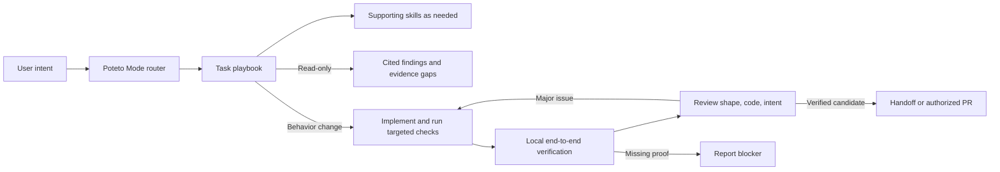

# bpstack — boosted pstack

**An Agent Skills stack for proving that software behaves the way the user asked.**

bpstack builds on [Lauren Tan’s pstack](https://github.com/cursor/plugins/tree/main/pstack) and the [potetos-for-everyone](https://github.com/TheOnlyFusionCube/potetos-for-everyone) portability adaptation. It pairs task-specific playbooks with a stricter rule for behavior changes: run the real app locally, exercise the changed path, and verify the result against the original request before opening a ready PR or shipping.

## Start here

From this checkout, try a single session without replacing your installed skills:

```sh
pi --no-extensions --no-skills --skill "$PWD/skills"
```

Then enter:

```text
/skill:poteto-mode Implement the requested change. Define observable acceptance cases, verify them through the actual app locally, and report what each check proved. Do not open a PR yet.
```

On hosts without skill commands, ask the agent to read `skills/poteto-mode/SKILL.md` and the selected playbook. The [setup tutorial](docs/setup.md) covers permanent user and project installation, checking discovery, and updating safely.

## How it works



- **Route once, load progressively.** Start with one playbook; add specific skills only when they change a decision.
- **Run the real entry point.** Drive the UI, CLI, consumer, or API. Fake external services at their boundaries rather than replacing the behavior under test.
- **Prove intent, not just execution.** Capture the expected and observed happy path and a relevant failure or boundary case, tied to the exact candidate.
- **Keep the gates explicit.** Review shape, code, and intent in order. If behavior proof is missing, report the blocker rather than claiming readiness. An explicitly requested draft can carry the gap; it cannot be marked ready or shipped on that evidence.

These are agent instructions, not a sandbox or a merge enforcement service. Your host's actual capabilities, permissions, and repository CI still matter.

## Documentation

| Guide | Use it to… |
| --- | --- |
| [Setup tutorial](docs/setup.md) | Install, confirm discovery, and manage upgrades. |
| [Workflows](docs/workflows.md) | See what implementation, investigation, review, and delivery look like, including a worked feature. |
| [Playbook guide](docs/playbooks.md) | Find the trigger and expected evidence for every playbook. |
| [Skill catalog and usage](docs/skills.md) | Browse available skills, directory conventions, and slash-command examples. |
| [Portability contract](PORTABILITY.md) | Understand what the agent does when its host lacks a capability. |
| [Contributing](CONTRIBUTING.md) | Add or change a skill without breaking discovery or weakening verification. |

## Credits and license

Original pstack / Poteto Mode by [Lauren Tan (@poteto)](https://github.com/poteto). bpstack is an independent downstream adaptation, not an official Cursor or pstack distribution. See [NOTICE.md](NOTICE.md) for provenance and [LICENSE](LICENSE) for the MIT terms.
