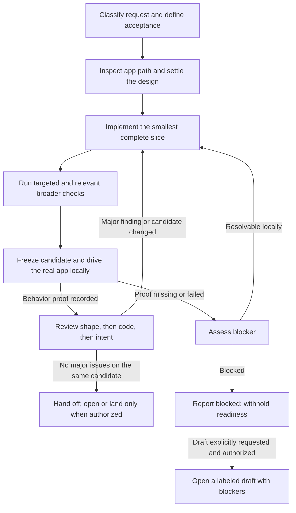

# Workflows

Use [Poteto Mode](../skills/poteto-mode/SKILL.md) to route a request by the outcome the user wants. Read the selected playbook in full, turn its steps into a checklist, and load supporting skills only when they change a decision. This guide explains the routes and handoffs; the linked playbooks contain the checklists.

Check the [portability contract](../PORTABILITY.md) before relying on delegation, execution, or access to a running app. Missing capabilities change what you can prove, not what counts as proof. Work locally first; permission to investigate a shared service does not imply permission to test a change against it.

## Choose a route

| User wants | Start with | What the agent delivers |
| --- | --- | --- |
| New user-visible behavior | [Feature](../skills/poteto-mode/playbooks/feature.md) | The smallest complete slice, with acceptance evidence and review. |
| A structural change with no behavior drift | [Refactoring](../skills/poteto-mode/playbooks/refactoring.md) | A caller map and the same behavior proof before and after. Treat drift as a bug. |
| A verdict on a design or diff | [Review and verify](../skills/poteto-mode/playbooks/review-and-verify.md); add [Interrogate](../skills/interrogate/SKILL.md) for contested or high-impact work | Findings tied to concrete failure modes, the candidate reviewed, and a verdict that names evidence gaps. |
| An explanation, not an edit | [Investigation](../skills/poteto-mode/playbooks/investigation.md) | A direct answer supported by evidence and a counter-check, with remaining uncertainty. |
| A known behavior fixed | [Bug fix](../skills/poteto-mode/playbooks/bug-fix.md) | A reproduction, a root-cause fix, and proof that the same failure no longer occurs. |
| A slow path improved or a metric raised | [Performance issue](../skills/poteto-mode/playbooks/perf-issue.md) or [Metric hillclimb](../skills/poteto-mode/playbooks/hillclimb.md) | Comparable measurements, a trace or benchmark, and guardrail results. |
| A PR opened, made ready, or landed | [Opening a PR](../skills/poteto-mode/playbooks/opening-a-pr.md), [Babysit](../skills/poteto-mode/playbooks/babysit.md), or [Shipping](../skills/poteto-mode/playbooks/shipping.md), respectively | The real PR identifier or landed revision, its verified state, and any blocker. |
| Sustained execution across units, PRs, or milestones | [Automation routes](#automation) | A checkpointed queue and proof for each completed unit; an explicit stop or handoff. |

If the request changes from diagnosis to implementation, switch to the appropriate implementation playbook; don't silently edit during an investigation. For cross-cutting work that fits none of the routes, use [Figure It Out](../skills/figure-it-out/SKILL.md) to define a completion predicate and design a verifiable sequence.

## Implementation, review, and verification

For behavior-changing work, follow this sequence:

1. **Specify the behavior.** Preserve the original request, name the observable outcome and a relevant negative case, and write down what's out of scope. Trace the normal consumer path. State the data shape or state transition before writing logic. Use [Architect](../skills/architect/SKILL.md) for non-trivial boundary changes and run early shape review when changing ownership, shared state, an interface, or a significant abstraction. Early review doesn't replace review of the final diff.
2. **Implement and test a slice.** Use [TDD](../skills/tdd/SKILL.md) when a small failing test can capture the outcome. Follow [Test Behavior, Not Implementation](../skills/principle-test-behavior-not-implementation/SKILL.md): assert what the consumer sees. Run targeted checks first, then broader checks justified by the affected callers and boundaries.
3. **Run real local E2E for behavior-changing work, regardless of patch size.** Start the actual app in isolation and drive its normal UI, CLI, or API. Fake external dependencies at their boundaries, not the changed app path. Prefer the project's verification skill or E2E harness; if coverage is missing, add and run a focused check when practical or drive the path manually and record the gap in automation. Record the exact candidate (commit and, for uncommitted changes, an identifiable diff or snapshot), command or steps, expected and observed results, external fakes, and artifact locations. Shut down the app and fakes. See [Prove It Works](../skills/principle-prove-it-works/SKILL.md) and [Create Verification Skill](../skills/create-verification-skill/SKILL.md).
4. **Review the same candidate in order.** Give each lens the original request, acceptance criteria, scope, diff, and verification evidence. Use one fresh read-only reviewer at a time: **shape** (layer, ownership, boundaries), **code** (correctness, regressions, tests), then **intent** (what the user asked for). Complete all three before editing the candidate. If isolated reviewers aren't available, run labeled sequential self-review and disclose that it wasn't independent. The implementing agent inspects the evidence, adjudicates findings, and owns fixes. A candidate change requires a new round; rerun affected checks, including any E2E whose result the change could invalidate.
5. **Hand off the result, not the activity.** Lead with impact and candidate revision. Include the key decision, verification commands and results, review verdicts, and any blocker or unverified surface. Unit tests, builds, direct handler calls, and green CI aren't substitutes for driving the changed path through the real local app. If local E2E is blocked, record `skip: <concrete reason>` and what remains unverified. Don't claim the behavior verified or the candidate ready.

## Investigation, bugs, and performance

- **Investigation:** State a falsifiable question, inspect the strongest sources, trace the relevant path, and try to disprove your leading explanation. For “should we do this?” use [Broader Scope Analysis](../skills/broader-scope-analysis/SKILL.md) before reading the diff. For a live symptom use [Runtime forensics](../skills/poteto-mode/playbooks/runtime-forensics.md); for an existing capture use [Trace forensics](../skills/poteto-mode/playbooks/trace-forensics.md). Cite the files, revisions, measurements, or trace intervals you actually used. Keep observations separate from inference.
- **Bug fix:** Capture expected versus observed behavior on the closest real surface. Use [Fix Root Causes](../skills/principle-fix-root-causes/SKILL.md) to trace the failure before editing. Where practical, lock in the reproduction with a failing behavior check. Make the smallest causal fix, replay the original reproduction through the actual local app, and run the review loop. If you can't reproduce it, report what you tried and gather evidence rather than guess.
- **Performance:** Record a user-visible baseline under controlled conditions and profile the actual path. Test one hypothesis at a time and compare on the same workload and environment. For repeated optimization, define a target and guardrails up front; keep only measured wins. Report commands, before/after results, guardrails, and residual costs. Measurements don't replace the implementation gate for a behavior-changing optimization.

## Opening and shipping

- **Opening a PR:** Inspect the full diff, run the required checks, and write a description that states impact and links proof for the exact candidate. For behavior-changing work, wait to open a PR until real local E2E passes and review clears. The only exception is when the user **explicitly requests a draft**: if authorized, open it as a draft and state the missing or failed proof and remaining blockers plainly. Don't mark it ready or land it until the gates pass. Return the real PR identifier and refreshed state.
- **Babysitting:** Inspect the current PR head, review threads, conflicts, and CI; resolve one real blocker at a time. Recheck the affected evidence on each new head. Stop at merge-ready or report the blocker. Making a PR ready is not permission to land it.
- **Shipping:** Freeze the exact heads and verify them against their acceptance criteria in dependency order. Behavior-changing heads need real local E2E and a clear review verdict; green CI alone is insufficient. Land only the contiguous verified run from the root, bottom-up, with authorization. Recheck head/base state after each landing and stop if the next candidate no longer matches what was verified. Report each landed revision and the first stop condition.

## Automation

| Scope | Route | Control and handoff |
| --- | --- | --- |
| One outcome across multiple steps | [Autonomous run](../skills/poteto-mode/playbooks/autonomous-run.md) | Define done and the authority boundary. Execute, verify, checkpoint, and replan in small units. Stop on completion or a real capability or permission blocker. |
| A queue of independent PRs | [Independent PR autopilot](../skills/poteto-mode/playbooks/autopilot-full.md) | Assign one owner per item. Obtain an independent verdict on each exact head before merge; reconcile the base and queue after each landing. If independent verification is unavailable, don't claim it or land under this route. |
| An ordered PR stack | [Linear stack autopilot](../skills/poteto-mode/playbooks/autopilot-stack.md) | Build on each verified layer, fix failures at the lowest causal layer, and hand off the ordered heads and per-layer proof. Don't land without a shipping request. |
| Multiple owners and milestones | [Project orchestration](../skills/poteto-mode/playbooks/orchestrate.md) | Partition by ownership, integrate reviewed artifacts rather than status reports, and verify the integrated milestone. Keep a dependency and decision log. |
| Turning a recurring workflow into a skill | [Automate Me](../skills/automate-me/SKILL.md) and [Authoring a skill](../skills/poteto-mode/playbooks/authoring-a-skill.md) | Derive triggers and quality gates from authorized examples, reuse existing playbooks, and validate both when the skill should and shouldn't trigger. |

Use [Show Me Your Work](../skills/show-me-your-work/SKILL.md) to record decisions and proof for long runs. If work must stop, follow [Pause safely](../skills/poteto-mode/playbooks/pause-safely.md) and leave the candidate revision, last proven state, blocker, and next discriminating check for [Session pickup](../skills/poteto-mode/playbooks/session-pickup.md). Automation schedules the work; it doesn't waive review, verification, or permissions.

## Worked example: export alerts to a file

This example describes a hypothetical application. The commands, candidate revision, and results show what a handoff would contain; they aren't commands or test results from this repository.

1. **Request and acceptance.** “Let on-call users export an incident's alerts to JSON.” `alerts export INC-42 --out alerts.json` must write the returned records and exit `0`. If the alerts service is unavailable, the command must report the error, exit nonzero, and leave an existing output file untouched. No new auth flow or changes to other commands.
2. **Route and design.** Choose [Feature](../skills/poteto-mode/playbooks/feature.md). Trace CLI dispatch, the configured HTTP client, and the file write. Reuse the alert record and existing client. The state transition is `output unchanged` → `JSON written` only after fetching and decoding a successful response. Early shape review checks the new CLI contract and confirms that HTTP belongs in the existing client, not the command parser.
3. **Implement and run targeted checks.** Add the command and focused success and failure tests. The acceptance check initially fails because the command is unknown. A first implementation fails the error case because it opens the output file before fetching. Move the write after fetch and decode, then rerun the focused tests.
4. **Run local E2E on the exact candidate.** Check out `9d1a3c450b26f013b8b65b4093442b5f6023188c` with no local changes. `./scripts/verify-alerts export` builds and invokes the real `./bin/alerts export INC-42 --out alerts.json` from a temporary directory. The harness sets `ALERTS_API_URL` to a loopback HTTP fake that serves the fixture for `GET /incidents/INC-42/alerts`. The CLI parser, network client, JSON handling, and file writing are real. The harness uses no live service or credentials and stops the fake afterward.
5. **Record evidence.** Targeted suite: `2 passed`. E2E stdout/stderr, exit codes, fake requests, and file checks are in `artifacts/verify-alerts-export.log`:

   | Case driven through the CLI | Observation |
   | --- | --- |
   | Fake returns `200` with `[{"id":"AL-7"}]` | Exit `0`; `alerts.json` parses to `[{"id":"AL-7"}]`. |
   | Fake returns `503`; output file starts with known contents | Exit `1`; stderr says `alerts service unavailable (503)`; the output file is byte-for-byte unchanged. |

6. **Clear review and hand off.** On `9d1a3c450b26f013b8b65b4093442b5f6023188c`, the shape reviewer confirms ownership of the HTTP boundary, the code reviewer checks the error path and preserved file, and the intent reviewer maps both E2E cases to the request. All three report no major issues on that unchanged candidate. The handoff links the evidence and names live-service behavior as unverified. The candidate is ready for a PR if opening one was authorized; no landing is implied. If the app couldn't run locally, the same handoff would instead report the blocker and withhold readiness, even if the focused tests passed.
